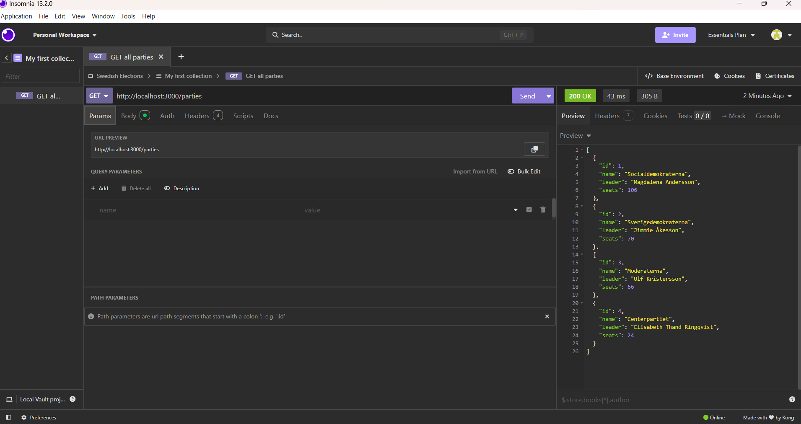
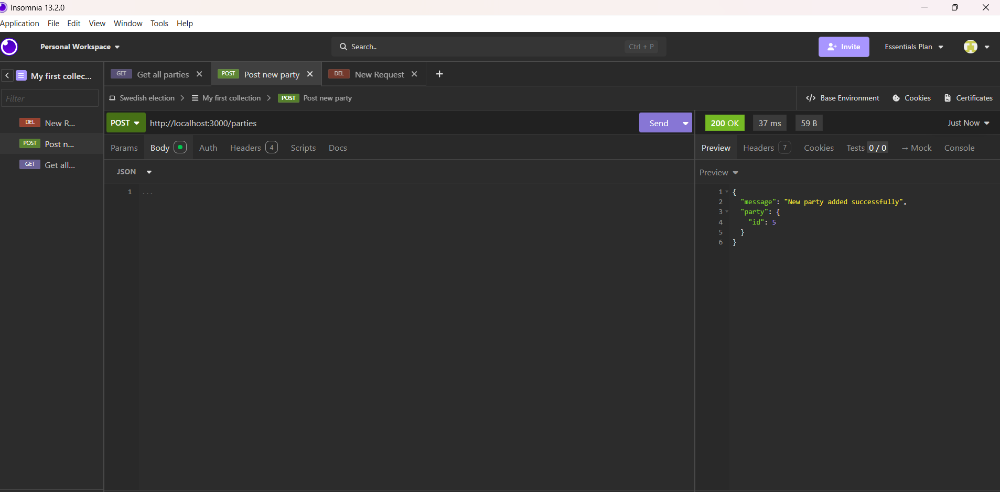
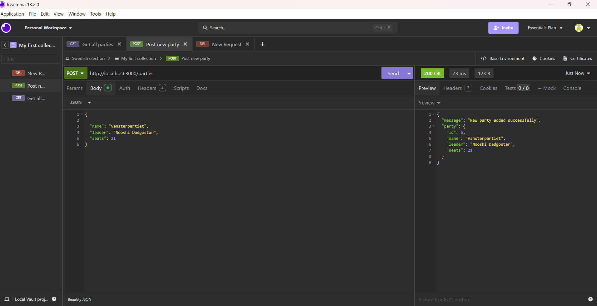
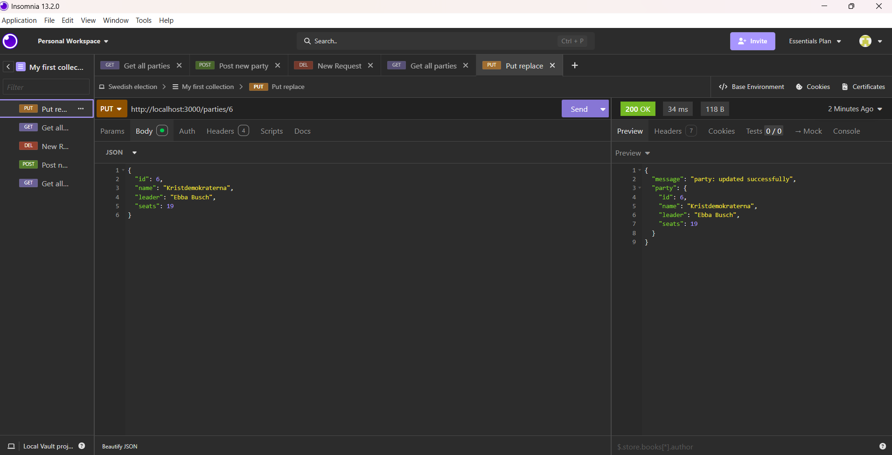
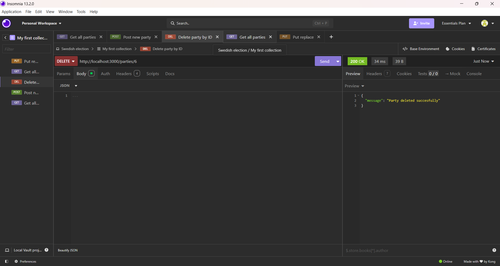
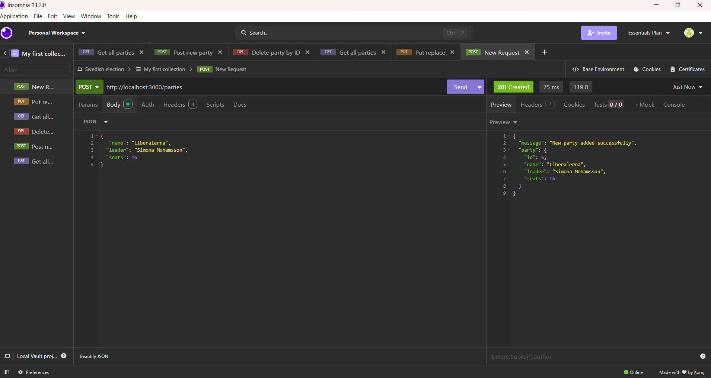
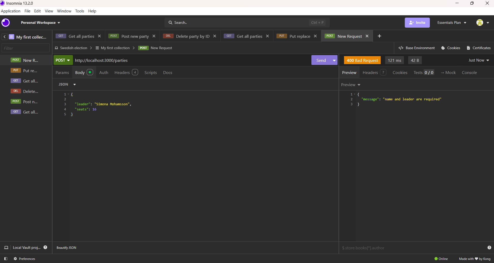
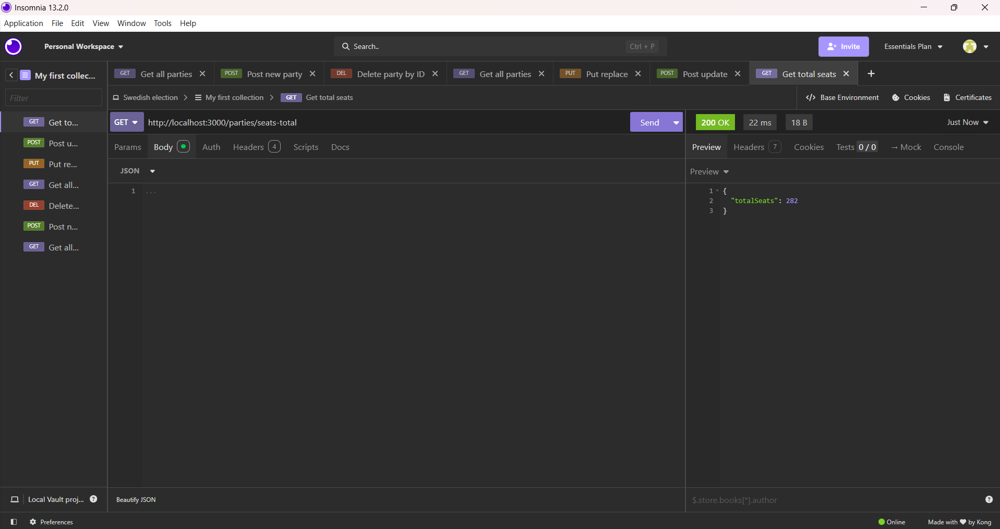

# Parties API

REST API built with **Express.js** and **TypeScript** 

server : `http://localhost:3000`

## Routes

##  1  `GET /parties` - get all parties

**Method:** `GET`
**Path:** `/parties`
**Description:** Displays all the objects in "parties" array.
**Request body:** none
**Returns:** the parties array of objects 
**Status codes:** `200 OK`

---

## 2 `POST /parties` - add new party(empty)

**Method:** `POST`
**Path:** `/parties`
**Description:** adds a new object to the array with a unique ID. The object is empty exept for the ID.
**Request body:** none
**Returns:** the new party added with a message: new party added succefully
**Status codes:** `200 OK`

---

## 3 `POST/parties`  - update POST/parties 

**Method:** `POST`
**Path:** `/parties`
**Description:** "updeted" version of POST/parties. The path is the same with the difference that now
the info about the party are added in the body as JSON.

**Request body:** JSON (screenshot)
**Returns:** a new party added with a message : new party added succefully.
**Status codes:** `200 OK`

---

##  4 `PUT /parties/:id` -  update party by replacing

**Method:** `PUT`
**Path:** `/parties/6`
**Description:** it finds tha party with the given ID and modifies it by replacing it complitely with an object
(added in the request body).It doesnt create or adds any new resouces, just replaces the existing one.

**Request body:** JSON (screenshot)
**Returns:** the party updated with the new info with a the message: party updated succefully.
**Status codes:** `200 OK`

## 5  `DELETE /parties/:id` - delete a party

**Method:** `DELETE`
**Path:** `/parties/6`
**Description:** it allows to delete the object with the given ID.
**Request body:** none
**Returns:** message : party deleted successfully
**Status codes:** `200 OK`

## 6 & 7  `POST/parties` - POST update, correct status code and bad input handling

**Method:** `POST`
**Path:** `/parties`
**Description:** POST/parties updated.
It returns the correct Status code (201),which is the standard status code for creating a new resource, when a new party is added.
It also checks that the fileds "name" and "leader"(properties of the object) are provided. Othewise, it rejects the request and gives back a Status code of (400).
**Request body:** JSON (screenshot)
**Returns:** the new party or message: name and leader are required
**Status codes:** `201 Created`, `400 Bad Request`
  
**Test — success (201):**

**Test — missing fields (400):**

## 8 `GET /parties/seats-total` - get total amount of seats

**Method:** `GET`
**Path:** `/parties/seats-total`
**Description:** it adds all the seats of the parties and displays the total amount of seats.
**Request body:** None
**Returns:** total amount of seats
**Status codes:** `200 OK`

